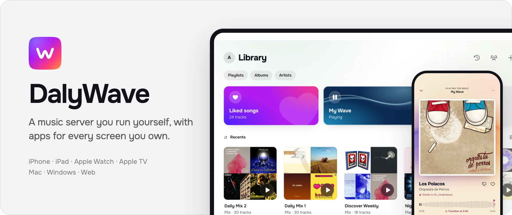
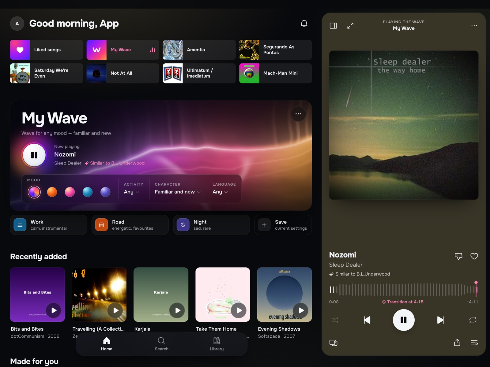
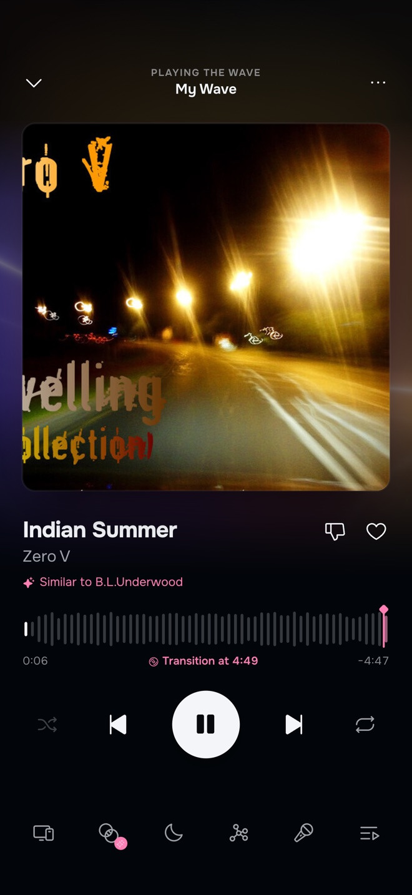
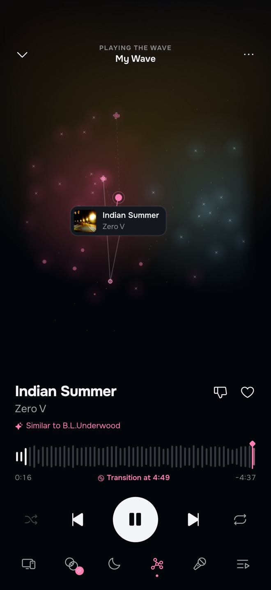
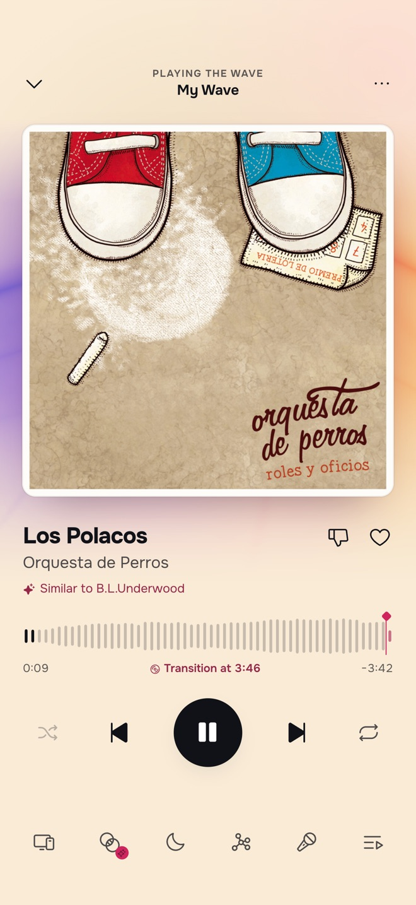
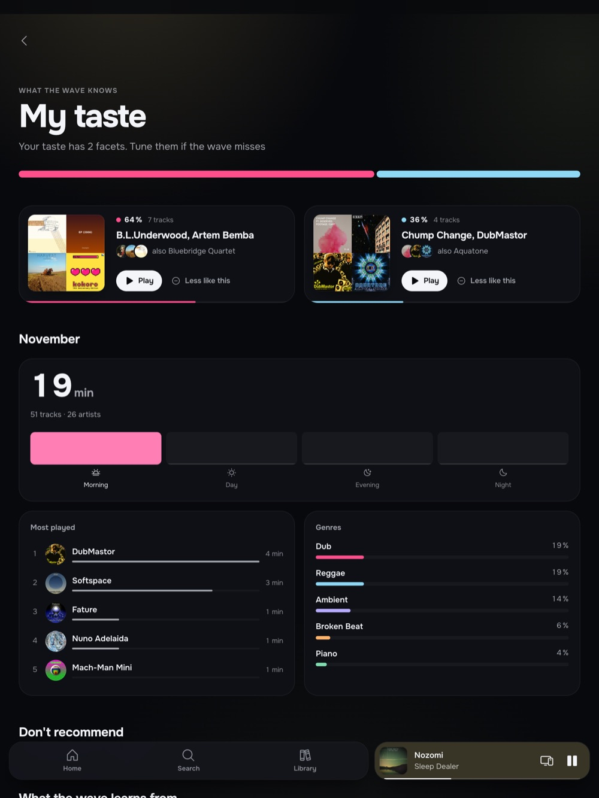
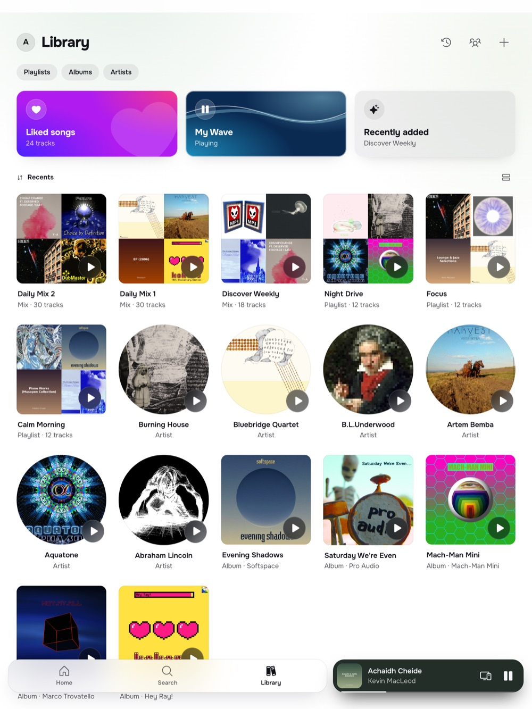

<picture>
  <source media="(prefers-color-scheme: dark)" srcset="docs/images/banner-dark.webp">
  
</picture>

<p align="center">
  English · <a href="README.ru.md">Русский</a>
</p>

DalyWave is a music server you run yourself, in the spirit of Jellyfin or Plex, but made only for
music. Point it at a folder of audio files: it reads the tags and covers, analyses the sound on your
own hardware and turns the collection into a library with an endless personal radio, smart mixes and
DJ-style transitions between tracks. The same interface runs in the browser and in native apps.

People sign in with accounts on the server itself or through any OpenID Connect provider. Nothing is
sent to outside recommendation or AI services: the analysis models run in a container next to the
server.

DalyWave is young (version 0.1). Expect rough edges and changes between releases.

<p align="center">
  
</p>

<p align="center">
  
  
  
</p>

<p align="center">
  
  
</p>

<p align="center"><sub>The screenshots show the demo library: Creative Commons music listed in
<a href="docs/demo/LICENSES.md">docs/demo/LICENSES.md</a>.</sub></p>

## Features

**Your music folder**

- Plays FLAC, MP3, AAC, Vorbis, WAV, ALAC, AIFF, Opus, APE, WavPack and Musepack files from your
  folders. Files are only read, never moved or modified.
- Reads the tags as they are (artists, album artist, track and disc numbers, genre, ISRC, MusicBrainz
  IDs, ReplayGain), with the folder path as a fallback. Embedded covers or `cover.jpg` and similar files.
- Watches the folders for changes. Renamed and moved files are recognised, so likes, playlists and
  history stay attached.
- Formats that browsers cannot play get a lossless or AAC copy on first play. Smaller Opus copies for
  slow mobile connections.
- Liked songs, playlists with folders, albums, artists and listening history. Loudness normalisation,
  a waveform seek bar and a 10-band equaliser.
- Synced lyrics from [LRCLIB](https://lrclib.net), with a full-screen view and tap to seek.
- Track credits from MusicBrainz and an artist summary from Wikipedia, for files with ISRC tags.

**Recommendations computed on your server**

- **My Wave**: endless personal radio that learns from likes and skips, with settings for activity,
  mood, familiar versus new, and language. The wave can also start from a track, an artist, an album,
  a playlist or a few words.
- Audio analysis on the CPU: tempo, key, energy, mood, voice and a beat grid for every track.
- Search by sound: describe it in words ("calm instrumental for work") and get matching tracks.
  Playlists from a short description.
- **My taste**: the facets of your taste, the month in numbers, "less like this". Every wave pick
  explains why it was chosen and can be shown on a map next to your taste.
- Daily mixes, a weekly discovery playlist, forgotten favourites and what you have on repeat.

**Playback**

- Gapless playback and crossfades. In the native apps, beat-matched DJ transitions: the next track
  is aligned to the phrase, tempo-matched and brought in with a bass swap, filter or echo.
- "Arrange as a set" orders a playlist by key, tempo and energy.
- Every browser tab and app is a device: play on one, control from another. The apps can move
  playback between Mac and iPhone when your headphones switch.
- Offline in the apps: keep tracks, albums and playlists on the device, plus a rotating reserve of
  wave tracks.

**Together**

- Friends, what they are listening to, taste match, private session.
- Collaborative playlists.
- Jam sessions that guests join by a link, without an account. Party mode: a full-screen view for a
  TV with a QR code for guests.
- Year in review from your listening history.
- Link previews for messengers, an embeddable player, a vertical video of a track with its cover,
  waveform and a line of lyrics, and a "now playing" overlay for streaming software.

**Import and export**

- Import from a Spotify data export, a Yandex Music playlist link, lists of "Artist — Title", CSV
  (Exportify) and M3U. Tracks are matched with the music on your server.
- Export the library, liked songs or a playlist as CSV, M3U8, JSON or a ZIP archive.

**Server**

- Accounts on the server and any number of OpenID Connect providers (Authentik, Keycloak, Pocket ID,
  Google and others). A first-run screen creates the administrator. Invites with a role and an
  expiry date, roles `admin` and `listener`.
- File storage in a local folder or in S3-compatible storage (Cloudflare R2, MinIO, SeaweedFS).
- Admin panel: library scan and skipped files, health of every component, people and sessions, who
  is listening now, audit log, storage use, per-listener recommendation details.
- Notifications in the app and through Web Push. Push to iPhone and iPad goes through APNs and needs
  the Apple key of the team that signed the app, so it works with your own build of the iOS app, not
  with the App Store version.
- The server announces itself on the local network (mDNS), so the apps can find it without typing an
  address. In Docker this needs host networking.
- OpenAPI 3.1 description at `/api/openapi.json`.
- Interface in English and Russian, dark and light themes.

### Optional modules

Both are off by default and are turned on separately with environment variables. Without them
DalyWave works with the music on your server only.

**Deezer catalog** (`DALYWAVE_DEEZER=true`). Uses the public Deezer API for metadata: search across
the whole catalog, full artist and album pages, similar artists, charts, upcoming releases, the
"Discover" feed, search for guests in Jam sessions and a scout that finds new music for the wave from
30-second previews. Files from your folder are matched with Deezer for higher-resolution covers.
Deezer provides metadata and previews, not full tracks: catalog tracks that are not on your server do
not play in full.

**Downloader** (`DALYWAVE_DOWNLOADER=true`). Fetches recordings with
[yt-dlp](https://github.com/yt-dlp/yt-dlp), either through the `fetcher` service on the server or on a
desktop computer running the app. It works together with the Deezer catalog and also enables short
music video clips in the player and downloads of new releases from followed artists. Downloading from
YouTube may violate its terms of service and the copyright law of your country. Whoever enables this
module is responsible for using it lawfully. Details are in
[docs/self-hosting/music.md](docs/self-hosting/music.md).

## Quick start

You need a machine with Docker. For the apps the server must be reachable over HTTPS: they accept
plain HTTP only for `localhost`.

```sh
mkdir dalywave && cd dalywave
curl -fsSLO https://raw.githubusercontent.com/dalywave/dalywave/main/infra/selfhost/docker-compose.yml
curl -fsSL -o .env https://raw.githubusercontent.com/dalywave/dalywave/main/infra/selfhost/.env.example
# edit .env: the public address, the secret key and the path to your music folder
docker compose up -d
```

Then open the site and create the administrator right away: until then the first-run screen is open
to anyone who reaches the server.

The images are `ghcr.io/dalywave/server` (API, job worker and web interface), `ghcr.io/dalywave/ml`
(audio analysis) and `ghcr.io/dalywave/fetcher` (the optional downloader). The full guide is
[docs/self-hosting/install.md](docs/self-hosting/install.md), the example settings are in
[infra/selfhost/.env.example](infra/selfhost/.env.example) and the compose file is
[infra/selfhost/docker-compose.yml](infra/selfhost/docker-compose.yml).

More on configuration:

- [Sign-in and roles](docs/self-hosting/auth.md): own accounts, OpenID Connect providers, invites
- [Music folders and optional modules](docs/self-hosting/music.md)
- [File storage](docs/self-hosting/storage.md): local folder or S3

Some of these guides are only in Russian for now.

## Apps

**Web.** The server serves the interface itself; open your server's address in a browser. It can be
added to the home screen of a phone.

**iPhone, iPad and Apple TV.** [DalyWave on the App Store](https://apps.apple.com/app/id6833942272).
The app connects to any DalyWave server: type its address or pick one found on your network. The
Apple TV signs in with a code on the screen or from an iPhone nearby. The Apple Watch app is a remote
for the iPhone app. The iPhone app also has widgets, Siri shortcuts, a share extension, AirPlay and
offline downloads.

**macOS and Windows.** A desktop app with the native audio engine: DJ transitions, offline downloads,
system media controls, a mini player, Discord status and, on macOS, a screensaver. Prebuilt
installers are not published yet; to build the app yourself, see
[apps/shell/README.md](apps/shell/README.md). Set `DALYWAVE_DEFAULT_SERVER=none` at build time so
that the first launch asks for a server address.

**Stream Deck.** A plugin with playback controls for whichever device is playing:
[apps/streamdeck](apps/streamdeck).

## Repository layout

```
apps/ui            Nuxt interface: the website, the admin panel and the screens of every app
apps/shell         Tauri shell: macOS, Windows, iPhone, iPad; Xcode targets for Apple TV and Watch
apps/streamdeck    Stream Deck plugin
crates/server      Rust server: API, sign-in, library, recommendations, job worker
crates/protocol    API types shared by the server and the apps
crates/client      native client core: audio engine, offline downloads, local store, sync
crates/taste       taste model
crates/transitions DJ transitions and set ordering
crates/textmatch   fuzzy matching of titles for search
services/ml        audio analysis (Python, ONNX Runtime)
services/fetcher   optional downloader (Python, yt-dlp)
infra              Dockerfile and compose files
docs               conventions, decisions, data model, self-hosting guides
```

## Development

Local setup, commands, tests and conventions are in [CONTRIBUTING.md](CONTRIBUTING.md). Report
security problems privately, as described in [SECURITY.md](SECURITY.md).

## License

DalyWave is free software under the [GNU Affero General Public License v3.0](LICENSE). If you run a
modified version for other people over a network, you must offer them its source code.

The `ml` service downloads third-party model weights when its image is built. They are not part of
this repository and keep their own licenses; the MTG models (Discogs-EffNet and its classifier heads)
are licensed CC BY-NC-SA 4.0, for non-commercial use only. The list of models and licenses is in
[services/ml/README.md](services/ml/README.md).
