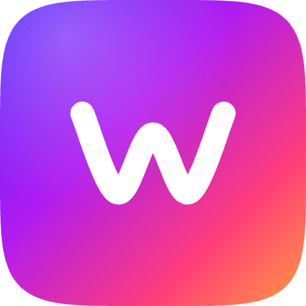
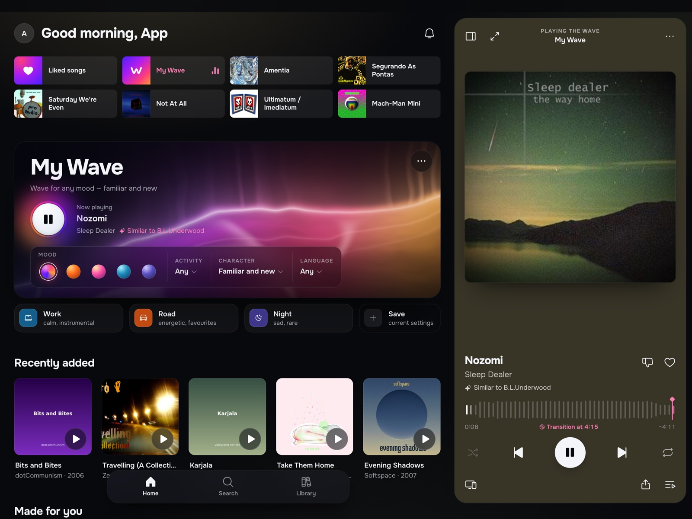
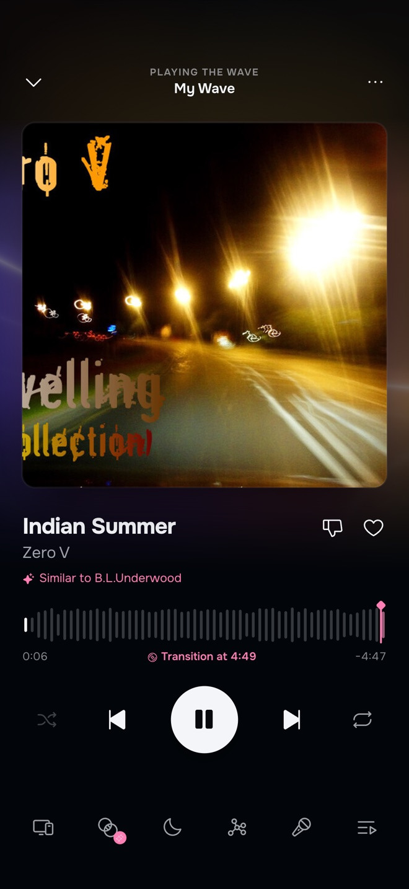
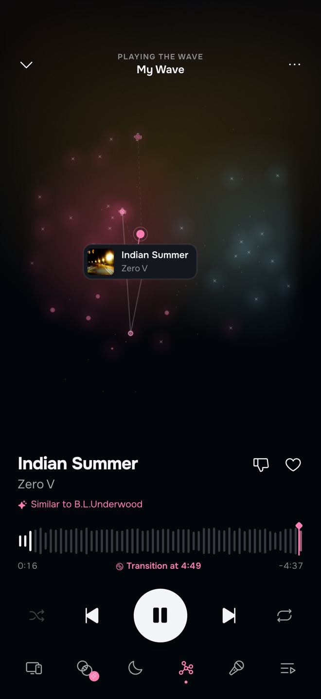
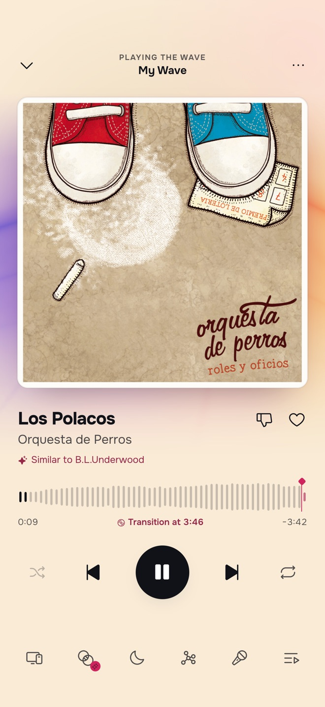
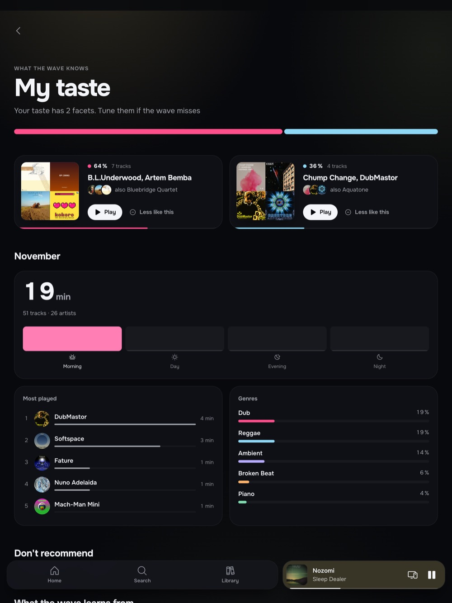
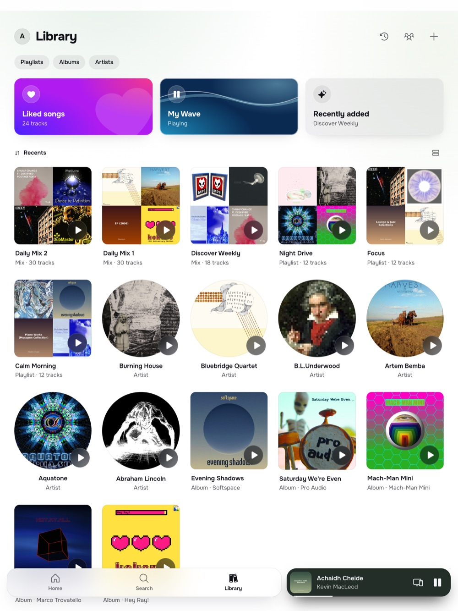

<p align="center">
  
</p>

<h1 align="center">DalyWave</h1>

<p align="center">
  Музыкальный сервер, который ставят себе, и приложения для сайта, iPhone, iPad, Apple TV, Apple Watch, macOS и Windows.
</p>

<p align="center">
  <a href="README.md">English</a> · Русский
</p>

DalyWave — музыкальный сервер, который вы ставите себе, как Jellyfin или Plex, но только для музыки.
Укажите ему папку с аудиофайлами: он прочитает теги и обложки, разберёт звучание на вашем же железе и
превратит коллекцию в медиатеку с бесконечной личной волной, умными миксами и переходами между
треками, как у диджея. Один и тот же интерфейс работает в браузере и в приложениях.

Входят своими аккаунтами на сервере или через любой провайдер OpenID Connect. Наружу, во внешние
сервисы рекомендаций или нейросетей, ничего не уходит: модели анализа работают в контейнере рядом с
сервером.

DalyWave молод (версия 0.1): возможны шероховатости и изменения между выпусками.

<p align="center">
  
</p>

<p align="center">
  
  
  
</p>

<p align="center">
  
  
</p>

<p align="center"><sub>На скриншотах — демо-медиатека: музыка под лицензиями Creative Commons, список —
в <a href="docs/demo/LICENSES.md">docs/demo/LICENSES.md</a>.</sub></p>

## Возможности

**Своя папка с музыкой**

- Играет файлы FLAC, MP3, AAC, Vorbis, WAV, ALAC, AIFF, Opus, APE, WavPack и Musepack из ваших папок.
  Файлы только читаются: сервер их не переносит и не меняет.
- Теги читаются как есть (исполнители, исполнитель альбома, номера трека и диска, жанр, ISRC,
  MusicBrainz ID, ReplayGain), недостающее берётся из пути. Обложки — встроенные или `cover.jpg` и
  похожие файлы в папке.
- Следит за изменениями в папках. Переименованные и перенесённые файлы узнаются: лайки, плейлисты и
  история остаются на месте.
- Для форматов, которые браузеры не играют, при первом воспроизведении делается копия без потерь или
  в AAC. Лёгкие копии в Opus — для слабой сотовой связи.
- Любимые треки, плейлисты с папками, альбомы, исполнители и история прослушиваний. Выравнивание
  громкости, перемотка по форме волны и 10-полосный эквалайзер.
- Тексты песен с синхронизацией из [LRCLIB](https://lrclib.net): на весь экран, нажатие на строку
  перематывает к ней.
- «Кто сделал трек» — из MusicBrainz, «Об артисте» — из Википедии, для файлов с тегом ISRC.

**Рекомендации считает ваш сервер**

- **«Моя волна»** — бесконечная личная волна, которая учится на лайках и пропусках. Настройки:
  занятие, настроение, знакомое или новое, язык. Волну можно запустить и от трека, исполнителя,
  альбома, плейлиста или пары слов.
- Анализ звука на процессоре: темп, тональность, энергия, настроение, голос и сетка долей у каждого
  трека.
- Поиск по звучанию: опишите его словами («спокойный инструментал для работы») и получите подходящие
  треки. Плейлист по короткому описанию.
- **«Мой вкус»** — грани вашего вкуса, месяц в цифрах, «Меньше такого». У каждого трека из волны
  можно узнать, почему он подобран, и увидеть его на карте рядом с вашим вкусом.
- Миксы дня, «Открытия недели», забытые любимые и то, что у вас на повторе.

**Воспроизведение**

- Без пауз и с плавным наложением. В приложениях — переходы «Диджей» с попаданием в долю: следующий
  трек входит с границы фразы, подстраивается по темпу и вводится сменой басов, фильтром или эхом.
- «Собрать как сет» расставляет плейлист по тональности, темпу и энергии.
- Каждая вкладка браузера и каждое приложение — устройство: играет одно, управлять можно с другого.
  Приложения умеют переносить музыку между Mac и iPhone, когда переключаются наушники.
- Без сети в приложениях: треки, альбомы и плейлисты на устройстве и обновляемый запас треков волны.

**Вместе**

- Друзья, что они слушают, совпадение вкусов, приватная сессия.
- Совместные плейлисты.
- «Слушать вместе»: гости приходят по ссылке, без аккаунта. Режим вечеринки — экран на весь
  телевизор с QR-кодом для гостей.
- Итоги года по истории прослушиваний.
- Превью ссылок для мессенджеров, встраиваемый плеер, вертикальное видео трека с обложкой, формой
  волны и строкой из текста, оверлей «Сейчас играет» для программ трансляции.

**Перенос и выгрузка**

- Перенос из архива данных Spotify, по ссылке на плейлист Яндекс Музыки, из списков «Исполнитель —
  Название», CSV (Exportify) и M3U. Треки сопоставляются с музыкой на вашем сервере.
- Выгрузка медиатеки, любимых треков или плейлиста в CSV, M3U8, JSON или архив ZIP.

**Сервер**

- Свои аккаунты на сервере и сколько угодно провайдеров OpenID Connect (Authentik, Keycloak,
  Pocket ID, Google и другие). Экран первого запуска создаёт администратора. Приглашения с ролью и
  сроком, роли `admin` и `listener`.
- Файлы сервера — в своей папке или в S3-совместимом хранилище (Cloudflare R2, MinIO, SeaweedFS).
- Админка: сканирование медиатеки и пропущенные файлы, здоровье каждой части, люди и сессии, кто
  слушает сейчас, журнал действий, занятое место, рекомендации по каждому слушателю.
- Уведомления в приложении и через Web Push; push на iPhone и iPad через APNs, если задан ключ Apple.
- Сервер объявляет себя в локальной сети (mDNS), и приложения находят его без ввода адреса. В Docker
  для этого нужна сеть хоста.
- Описание API в OpenAPI 3.1 — `/api/openapi.json`.
- Интерфейс на русском и английском, тёмная и светлая темы.

### Необязательные модули

Оба выключены по умолчанию и включаются отдельно, переменными окружения. Без них DalyWave работает
только с музыкой на вашем сервере.

**Каталог Deezer** (`DALYWAVE_DEEZER=true`). Открытый API Deezer для метаданных: поиск по всему
каталогу, полные страницы исполнителей и альбомов, похожие исполнители, чарты, будущие релизы, лента
«Открытия», поиск для гостей в «Слушать вместе» и разведчик, который ищет новую музыку для волны по
30-секундным превью. Файлы из папки сопоставляются с Deezer ради обложек в высоком качестве. Deezer
даёт метаданные и превью, а не треки целиком: трек из каталога, которого нет на сервере, целиком не
играет.

**Загрузчик** (`DALYWAVE_DOWNLOADER=true`). Скачивает записи через
[yt-dlp](https://github.com/yt-dlp/yt-dlp) — сервисом `fetcher` на сервере или на компьютере с
приложением. Работает вместе с каталогом Deezer, а ещё включает короткие клипы в плеере и докачку
новых релизов исполнителей из подписок. Скачивание с YouTube может нарушать его условия использования
и закон об авторском праве вашей страны. Ответственность за законное использование — на том, кто
включает модуль. Подробнее — [docs/self-hosting/music.md](docs/self-hosting/music.md).

## Быстрый старт

Нужна машина с Docker. Для приложений сервер должен быть доступен по HTTPS: простой HTTP они
принимают только для `localhost`.

```sh
mkdir dalywave && cd dalywave
curl -fsSLO https://raw.githubusercontent.com/dalywave/dalywave/main/infra/selfhost/docker-compose.yml
curl -fsSL -o .env https://raw.githubusercontent.com/dalywave/dalywave/main/infra/selfhost/.env.example
# в .env: публичный адрес, секретный ключ и путь к папке с музыкой
docker compose up -d
```

Затем откройте сайт и сразу создайте администратора: до этого экран первого запуска открыт любому,
кто зайдёт на сервер.

Образы: `ghcr.io/dalywave/server` (API, исполнитель задач и веб-интерфейс), `ghcr.io/dalywave/ml`
(анализ звука) и `ghcr.io/dalywave/fetcher` (необязательный загрузчик). Полная инструкция —
[docs/self-hosting/install.md](docs/self-hosting/install.md), пример настроек —
[infra/selfhost/.env.example](infra/selfhost/.env.example), файл compose —
[infra/selfhost/docker-compose.yml](infra/selfhost/docker-compose.yml).

О настройке подробнее:

- [Вход и роли](docs/self-hosting/auth.md): свои аккаунты, провайдеры OpenID Connect, приглашения
- [Папки с музыкой и необязательные модули](docs/self-hosting/music.md)
- [Хранилище файлов](docs/self-hosting/storage.md): своя папка или S3

## Приложения

**Сайт.** Интерфейс отдаёт сам сервер: откройте его адрес в браузере. Сайт можно добавить на экран
«Домой» телефона.

**iPhone, iPad и Apple TV.** [DalyWave в App Store](https://apps.apple.com/app/id6833942272).
Приложение подключается к любому серверу DalyWave: введите адрес или выберите найденный в вашей сети.
Apple TV входит кодом с экрана или с iPhone рядом. Приложение для Apple Watch — пульт к приложению на
iPhone. На iPhone есть ещё виджеты, команды Siri, расширение «Поделиться», AirPlay и загрузки для
прослушивания без сети.

**macOS и Windows.** Приложение для компьютера со своим аудиодвижком: переходы «Диджей», загрузки без
сети, системные элементы управления музыкой, мини-плеер, статус в Discord, а на macOS — заставка.
Готовые установщики пока не выложены; как собрать приложение самому — в
[apps/shell/README.md](apps/shell/README.md). Задайте при сборке `DALYWAVE_DEFAULT_SERVER=none`,
чтобы при первом запуске приложение спросило адрес сервера.

**Stream Deck.** Плагин с кнопками управления музыкой на том устройстве, где она играет:
[apps/streamdeck](apps/streamdeck).

## Устройство репозитория

```
apps/ui            интерфейс на Nuxt: сайт, админка и экраны всех приложений
apps/shell         оболочка на Tauri: macOS, Windows, iPhone, iPad; цели Xcode для Apple TV и Watch
apps/streamdeck    плагин Stream Deck
crates/server      сервер на Rust: API, вход, медиатека, рекомендации, исполнитель задач
crates/protocol    типы API, общие для сервера и приложений
crates/client      ядро приложений: аудиодвижок, загрузки на устройство, локальная база, синхронизация
crates/taste       модель вкуса
crates/transitions переходы «Диджей» и порядок для сета
crates/textmatch   нечёткое сравнение названий для поиска
services/ml        анализ звука (Python, ONNX Runtime)
services/fetcher   необязательный загрузчик (Python, yt-dlp)
infra              Dockerfile и файлы compose
docs               соглашения, решения, модель данных, инструкции для своего сервера
```

## Разработка

Локальный запуск, команды, тесты и соглашения — в [CONTRIBUTING.md](CONTRIBUTING.md) (на английском).
Об уязвимостях сообщайте приватно, как описано в [SECURITY.md](SECURITY.md).

## Лицензия

DalyWave — свободная программа под лицензией [GNU Affero General Public License v3.0](LICENSE). Если вы
даёте другим людям пользоваться изменённой версией по сети, вы обязаны предложить им её исходный код.

Сервис `ml` при сборке образа скачивает веса чужих моделей. Они не входят в этот репозиторий и
остаются под своими лицензиями; модели MTG (Discogs-EffNet и его классификаторы) — под CC BY-NC-SA 4.0,
только для некоммерческого использования. Список моделей и лицензий — в
[services/ml/README.md](services/ml/README.md).
