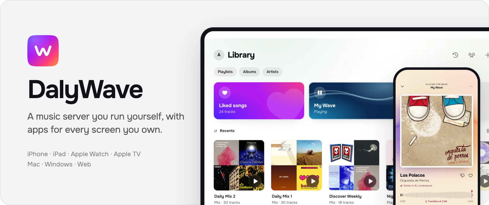
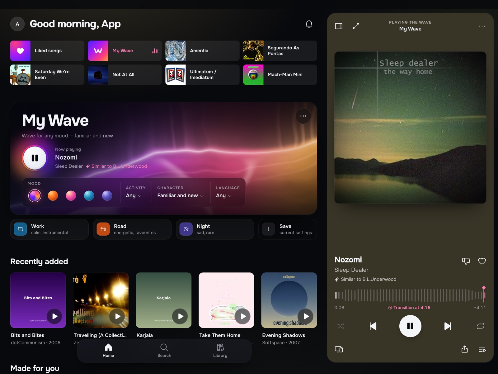
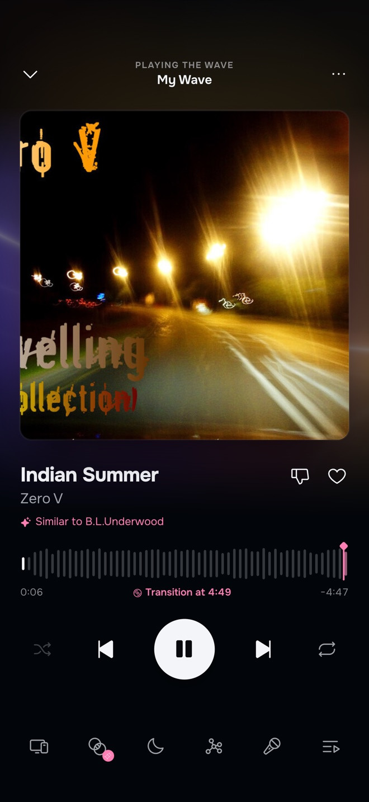
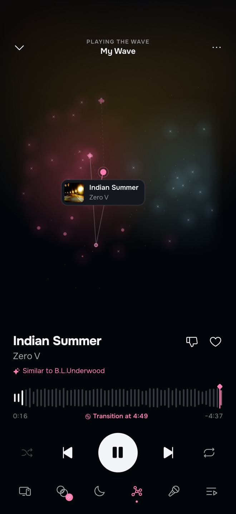
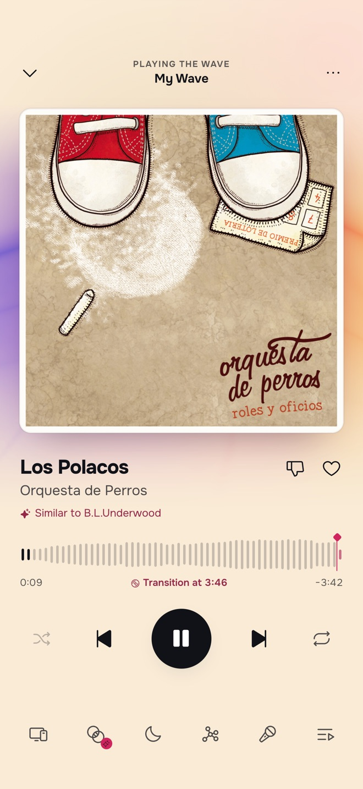
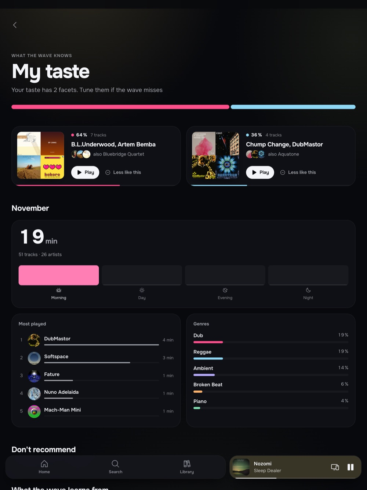
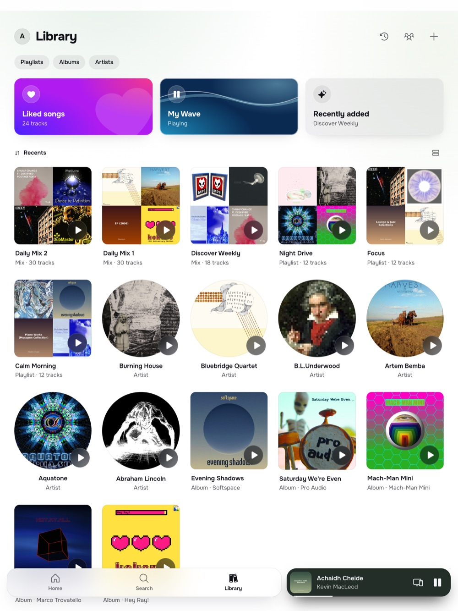

<picture>
  <source media="(prefers-color-scheme: dark)" srcset="docs/images/banner-dark.webp">
  
</picture>

<p align="center">
  <a href="README.md">English</a> · <a href="README.ru.md">Русский</a> · Українська
</p>

DalyWave — музичний сервер, який ви встановлюєте собі, як Jellyfin чи Plex, але тільки для музики.
Укажіть йому папку з аудіофайлами: він прочитає теги й обкладинки, проаналізує звучання на вашому ж
обладнанні та перетворить колекцію на медіатеку з нескінченною особистою хвилею, розумними міксами й
переходами між треками, як у діджея. Той самий інтерфейс працює в браузері та в застосунках.

Увійти можна з власним обліковим записом на сервері або через будь-який провайдер OpenID Connect.
Назовні, у сторонні сервіси рекомендацій чи нейромереж, нічого не надсилається: моделі аналізу
працюють у контейнері поруч із сервером.

DalyWave ще молодий (версія 0.1): можливі недоробки й зміни між випусками.

<p align="center">
  
</p>

<p align="center">
  
  
  
</p>

<p align="center">
  
  
</p>

<p align="center"><sub>На знімках екрана — демонстраційна медіатека: музика за ліцензіями Creative Commons,
список — у <a href="docs/demo/LICENSES.md">docs/demo/LICENSES.md</a>.</sub></p>

## Можливості

**Власна папка з музикою**

- Відтворює файли FLAC, MP3, AAC, Vorbis, WAV, ALAC, AIFF, Opus, APE, WavPack і Musepack із ваших папок.
  Файли лише читаються: сервер їх не переносить і не змінює.
- Теги читаються як є (виконавці, виконавець альбому, номери трека й диска, жанр, ISRC,
  MusicBrainz ID, ReplayGain), чого бракує — береться зі шляху. Обкладинки — вбудовані або `cover.jpg`
  і схожі файли в папці.
- Стежить за змінами в теках. Перейменовані й перенесені файли розпізнаються: вподобання, плейлисти й
  історія лишаються на місці.
- Для форматів, які браузери не відтворюють, під час першого відтворення робиться копія без втрат або
  в AAC. Легкі копії в Opus — для слабкого мобільного зв’язку.
- Вподобані треки, плейлисти з теками, альбоми, виконавці та історія прослуховувань. Вирівнювання
  гучності, перемотування за формою хвилі й 10-смуговий еквалайзер.
- Синхронізовані тексти пісень з [LRCLIB](https://lrclib.net): на весь екран, натискання на рядок
  перемотує до нього.
- «Хто створив трек» — з MusicBrainz, «Про виконавця» — з Вікіпедії, для файлів із тегом ISRC.

**Рекомендації обчислює ваш сервер**

- **«Моя хвиля»** — нескінченна особиста хвиля, яка вчиться на вподобаннях і пропусках. Налаштування:
  заняття, настрій, знайоме чи нове, мова. Хвилю можна почати й з трека, виконавця, альбому, плейлиста
  або кількох слів.
- Аналіз звуку на процесорі: темп, тональність, енергія, настрій, голос і ритмічна сітка для кожного
  трека.
- Пошук за звучанням: опишіть його словами («спокійний інструментал для роботи») і отримайте відповідні
  треки. Плейлист за коротким описом.
- **«Мій смак»** — грані вашого смаку, місяць у цифрах, «Менше такого». Для кожного трека з хвилі можна
  дізнатися, чому його підібрано, і побачити його на мапі поруч із вашим смаком.
- Мікси дня, «Відкриття тижня», забуті улюблені й те, що у вас на повторі.

**Відтворення**

- Без пауз і з плавним накладанням. У застосунках — переходи «Діджей» із влученням у долю: наступний
  трек входить з межі фрази, підлаштовується під темп і вводиться заміною басів, фільтром або ехом.
- «Зібрати як сет» розставляє плейлист за тональністю, темпом і енергією.
- Кожна вкладка браузера й кожен застосунок — пристрій: грає один, керувати можна з іншого.
  Застосунки вміють переносити музику між Mac і iPhone, коли перемикаються навушники.
- Без мережі в застосунках: треки, альбоми й плейлисти на пристрої та оновлюваний запас треків хвилі.

**Разом**

- Друзі, що вони слухають, збіг смаків, приватний сеанс.
- Спільні плейлисти.
- «Слухати разом»: гості приходять за посиланням, без облікового запису. Режим вечірки — екран на весь
  телевізор із QR-кодом для гостей.
- Підсумки року за історією прослуховувань.
- Прев’ю посилань для месенджерів, плеєр для вбудовування, вертикальне відео трека з обкладинкою,
  формою хвилі й рядком із тексту, оверлей «Зараз грає» для програм трансляції.

**Перенесення та вивантаження**

- Перенесення з архіву даних Spotify, за посиланням на плейлист Яндекс Музики, зі списків «Виконавець —
  Назва», CSV (Exportify) і M3U. Треки зіставляються з музикою на вашому сервері.
- Вивантаження медіатеки, вподобаних треків або плейлиста в CSV, M3U8, JSON чи архів ZIP.

**Сервер**

- Власні облікові записи на сервері та скільки завгодно провайдерів OpenID Connect (Authentik,
  Keycloak, Pocket ID, Google та інші). Екран першого запуску створює адміністратора. Запрошення з роллю
  і строком дії, ролі `admin` і `listener`.
- Файли сервера — у власній папці або в S3-сумісному сховищі (Cloudflare R2, MinIO, SeaweedFS).
- Адмінка: сканування медіатеки й пропущені файли, здоров’я кожної частини, люди й сесії, хто слухає
  зараз, журнал дій, зайняте місце, рекомендації для кожного слухача.
- Сповіщення в застосунку та через Web Push. Push на iPhone і iPad іде через APNs і потребує ключа
  Apple тієї команди, що підписала застосунок: він працює з власною збіркою застосунку для iOS, але не
  з версією з App Store.
- Сервер оголошує себе в локальній мережі (mDNS), і застосунки знаходять його без введення адреси.
  У Docker для цього потрібна мережа хоста.
- Опис API в OpenAPI 3.1 — `/api/openapi.json`.
- Інтерфейс українською, англійською та російською, темна й світла теми.

### Необов’язкові модулі

Обидва за замовчуванням вимкнені й вмикаються окремо, змінними середовища. Без них DalyWave працює
лише з музикою на вашому сервері.

**Каталог Deezer** (`DALYWAVE_DEEZER=true`). Відкритий API Deezer для метаданих: пошук у всьому
каталозі, повні сторінки виконавців і альбомів, схожі виконавці, чарти, майбутні релізи, стрічка
«Відкриття», пошук для гостей у «Слухати разом» і розвідник, який шукає нову музику для хвилі за
30-секундними прев’ю. Файли з папки зіставляються з Deezer, щоб отримати обкладинки у високій якості.
Deezer дає метадані й прев’ю, а не треки цілком: трек із каталогу, якого немає на сервері, повністю
не відтворюється.

**Завантажувач** (`DALYWAVE_DOWNLOADER=true`). Завантажує записи через
[yt-dlp](https://github.com/yt-dlp/yt-dlp) — сервісом `fetcher` на сервері або на комп’ютері із
застосунком. Працює разом із каталогом Deezer, а ще вмикає короткі кліпи в плеєрі й дозавантаження
нових релізів виконавців із підписок. Завантаження з YouTube може порушувати його умови використання
та закон про авторське право вашої країни. Відповідальність за законне використання — на тому, хто
вмикає модуль. Докладніше — [docs/self-hosting/music.uk.md](docs/self-hosting/music.uk.md).

## Швидкий старт

Потрібна машина з Docker. Для застосунків сервер має бути доступний через HTTPS: звичайний HTTP вони
приймають лише для `localhost`.

```sh
mkdir dalywave && cd dalywave
curl -fsSLO https://raw.githubusercontent.com/dalywave/dalywave/main/infra/selfhost/docker-compose.yml
curl -fsSL -o .env https://raw.githubusercontent.com/dalywave/dalywave/main/infra/selfhost/.env.example
# у .env: публічна адреса, секретний ключ, пароль бази даних і шлях до папки з музикою
docker compose up -d
```

Потім відкрийте сайт і одразу створіть адміністратора: доти екран першого запуску відкритий для
будь-кого, хто зайде на сервер.

Образи: `ghcr.io/dalywave/server` (API, обробник завдань і вебінтерфейс), `ghcr.io/dalywave/ml`
(аналіз звуку) і `ghcr.io/dalywave/fetcher` (необов’язковий завантажувач). Повна інструкція —
[docs/self-hosting/install.uk.md](docs/self-hosting/install.uk.md), приклад налаштувань —
[infra/selfhost/.env.example](infra/selfhost/.env.example), файл compose —
[infra/selfhost/docker-compose.yml](infra/selfhost/docker-compose.yml).

Докладніше про налаштування:

- [Вхід і ролі](docs/self-hosting/auth.uk.md): власні облікові записи, провайдери OpenID Connect,
  запрошення
- [Папки з музикою та необов’язкові модулі](docs/self-hosting/music.uk.md)
- [Сховище файлів](docs/self-hosting/storage.uk.md): власна папка або S3

## Застосунки

**Сайт.** Інтерфейс віддає сам сервер: відкрийте його адресу в браузері. Сайт можна додати на
початковий екран телефона.

**iPhone, iPad і Apple TV.** [DalyWave в App Store](https://apps.apple.com/app/id6833942272).
Застосунок під’єднується до будь-якого сервера DalyWave: введіть адресу або виберіть знайдений у вашій
мережі. Apple TV входить за кодом з екрана або через iPhone поруч. Застосунок для Apple Watch — пульт
до застосунку на iPhone. На iPhone є ще віджети, команди Siri, розширення «Поділитися», AirPlay і
завантаження для прослуховування без мережі.

**macOS і Windows.** Застосунок для комп’ютера з власним аудіорушієм: переходи «Діджей», завантаження
без мережі, системні елементи керування музикою, мініплеєр, статус у Discord, а на macOS — заставка.
Готових інсталяторів поки немає; як зібрати застосунок самостійно — у
[apps/shell/README.md](apps/shell/README.md). Задайте при збиранні `DALYWAVE_DEFAULT_SERVER=none`,
щоб під час першого запуску застосунок запитав адресу сервера.

**Stream Deck.** Плагін із кнопками керування музикою на тому пристрої, де вона грає:
[apps/streamdeck](apps/streamdeck).

## Будова репозиторію

```
apps/ui            інтерфейс на Nuxt: сайт, адмінка й екрани всіх застосунків
apps/shell         оболонка на Tauri: macOS, Windows, iPhone, iPad; цілі Xcode для Apple TV і Watch
apps/streamdeck    плагін Stream Deck
crates/server      сервер на Rust: API, вхід, медіатека, рекомендації, обробник завдань
crates/protocol    типи API, спільні для сервера й застосунків
crates/client      ядро застосунків: аудіорушій, завантаження на пристрій, локальна база, синхронізація
crates/taste       модель смаку
crates/transitions переходи «Діджей» і порядок для сету
crates/textmatch   нечітке порівняння назв для пошуку
services/ml        аналіз звуку (Python, ONNX Runtime)
services/fetcher   необов’язковий завантажувач (Python, yt-dlp)
infra              Dockerfile і файли compose
docs               домовленості, рішення, модель даних, інструкції для власного сервера
```

## Розробка

Локальний запуск, команди, тести й домовленості — у [CONTRIBUTING.md](CONTRIBUTING.md) (англійською).
Про вразливості повідомляйте приватно, як описано в [SECURITY.md](SECURITY.md).

## Ліцензія

DalyWave — вільна програма за ліцензією [GNU Affero General Public License v3.0](LICENSE). Якщо ви
даєте іншим людям користуватися зміненою версією через мережу, ви зобов’язані запропонувати їм її
вихідний код. [Додатковий дозвіл](APP-STORE-EXCEPTION.md) дає змогу поширювати DalyWave через магазини
застосунків, наприклад App Store, якщо вихідний код лишається доступним за тією самою ліцензією.

Сервіс `ml` використовує сторонні моделі, у них власні ліцензії. CLAP, Beat This! і S-KEY входять до
його образу, тексти ліцензій — у `/usr/share/doc/dalywave-ml`. Моделі MTG (Discogs-EffNet і його
класифікатори) — за CC BY-NC-SA 4.0, лише для некомерційного використання, тому в образі їх немає:
під час першого запуску контейнер завантажує їх із сайту авторів у том `ml-models` і кладе поруч
відомості про авторство. Список моделей і ліцензій — у [services/ml/README.md](services/ml/README.md).
